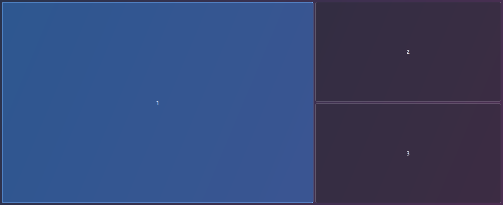
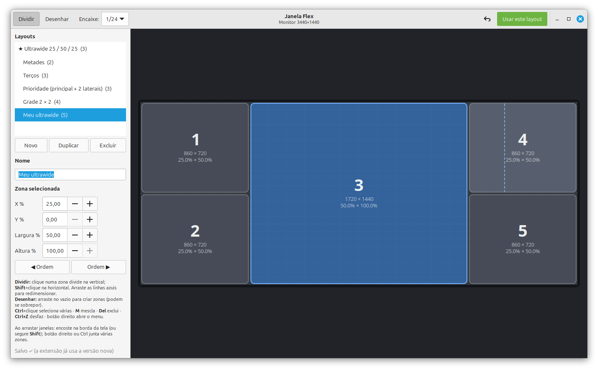

# Janela Flex

Zonas de janelas personalizadas para o **Cinnamon** (Linux Mint), no estilo do FancyZones do Windows.
Você desenha os seus próprios layouts num editor visual e, ao arrastar uma janela, solta ela numa zona.





## Recursos

- **Editor visual de layouts**: divida as zonas com um clique, arraste as divisórias, mescle, desenhe zonas livres (podem se sobrepor) e digite valores exatos em %.
- **12 modelos prontos**: metades, terços, 25/50/25 para ultrawide, 2/3 + 1/3, grades, "prioridade" e outros.
- **Encaixe ao arrastar**: as zonas aparecem quando o mouse encosta na borda da tela (ou segurando Shift). Um arraste curto no meio da tela continua livre.
- **Várias zonas ao mesmo tempo**: com as zonas visíveis, segure Ctrl (ou o botão direito) e passe por cima de várias.
- **Atalhos de teclado** para mandar a janela para uma zona sem usar o mouse.
- **Espaço entre janelas** configurável.
- **Layout por monitor**, trocado na hora com um atalho.
- Desliga o encaixe nativo do Cinnamon só enquanto as zonas estão visíveis, para os dois não brigarem.

## Compatibilidade

| Ambiente | Situação |
|---|---|
| Linux Mint 22.1 · Cinnamon **6.4** · X11 | ✅ Testado |
| Cinnamon 5.4 – 6.6 | ⚠️ Declarado no `metadata.json`, mas não testado |
| Sessão Wayland do Cinnamon | ❓ Não testado |

Requisitos: `python3` e `python3-gi` com GTK 3 (já vêm instalados no Linux Mint).

## Instalação

```bash
git clone https://github.com/guiwisz/janela-flex.git
cp -r janela-flex/janela-flex@guilherme ~/.local/share/cinnamon/extensions/
```

Depois ative a extensão em **Configurações do Sistema → Extensões → Janela Flex**.

> Se você vai mexer no código, use um link simbólico no lugar do `cp`:
> `ln -s "$PWD/janela-flex/janela-flex@guilherme" ~/.local/share/cinnamon/extensions/`

## Uso

### Arrastando janelas
- Arraste uma janela até **encostar o mouse numa borda da tela** (ou segure **Shift** enquanto arrasta). As zonas aparecem.
- Leve até a zona desejada e solte.
- Para ocupar **várias zonas**, segure **Ctrl** ou o **botão direito** e passe sobre elas.

### Atalhos

| Atalho | Ação |
|---|---|
| `Super+Alt+←` / `Super+Alt+→` | Zona anterior / próxima |
| `Super+Alt+1` … `9` | Manda a janela para a zona N |
| `Super+Alt+↑` | Troca para o próximo layout |
| `Super+Alt+E` | Abre o editor de layouts |

Todos podem ser mudados nas configurações da extensão.

### Editor de layouts
Abra com `Super+Alt+E` ou pelo botão nas configurações da extensão.

- **Modo Dividir**: clique numa zona para dividi-la na vertical, ou use **Shift**+clique para dividir na horizontal. Arraste as linhas azuis para redimensionar as zonas vizinhas juntas.
- **Modo Desenhar**: arraste no vazio para criar uma zona, arraste uma zona para movê-la, e use o canto inferior direito para redimensioná-la.
- **Ctrl**+clique seleciona várias zonas · **M** mescla · **Del** exclui · **Ctrl+Z** desfaz · o botão direito abre o menu.
- **Encaixe**: alinha a uma grade (1/4 … 1/48 da tela ou 1%).
- **Usar este layout**: torna o layout atual o ativo.

Tudo é salvo automaticamente em `~/.config/janela-flex/layouts.json`, e a extensão recarrega na hora.

## Configurações

Ficam em **Configurações do Sistema → Extensões → Janela Flex → ⚙**:

- **Quando mostrar as zonas**: ao encostar na borda, segurando Shift, segurando Ctrl, segurando Alt ou sempre.
- **Espaço entre janelas** (px).
- **Desligar o encaixe nativo** enquanto as zonas estão visíveis.
- **Atalhos de teclado**.

## Estrutura

```
janela-flex@guilherme/
├── extension.js          # extensão do Cinnamon (zonas, arrastar, atalhos)
├── editor.py             # editor de layouts (Python + GTK 3)
├── defaults.json         # layouts iniciais
├── settings-schema.json  # tela de configurações
├── stylesheet.css        # aparência das zonas
└── metadata.json
```

## Contribuindo

Melhorias são bem-vindas! Faça um fork, crie um branch e abra um pull request.
Para ver os logs da extensão: `grep janela-flex ~/.xsession-errors`.
Para recarregá-la sem reiniciar o Cinnamon, desative e reative a extensão (ou use o Looking Glass, com `Alt+F2` → `lg`).

## Licença

[MIT](LICENSE) © 2026 Guilherme Wiszniewski.

Você pode usar, modificar e redistribuir, inclusive em projetos comerciais, **desde que mantenha o aviso de copyright e a licença**, ou seja, os créditos ao autor original.
